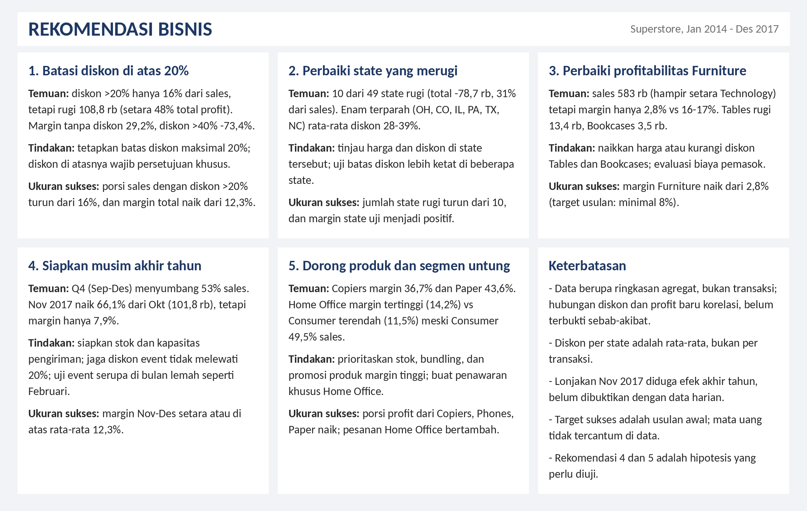

# Analisis Penjualan Superstore (SQL + Power BI)

Analisis 9.993 baris transaksi toko retail Amerika Serikat (Jan 2014 – Des 2017) untuk memahami tren penjualan, profitabilitas per kategori dan wilayah, serta pengaruh diskon terhadap profit. Proyek ini memakai SQL (MySQL) untuk eksplorasi, cleaning, dan analisis, lalu Power BI untuk dashboard.


## 1. Masalah Bisnis

**Stakeholder:** Manajer Penjualan.

Penjualan terus naik, tetapi margin profit belum ikut membaik. Pertanyaan yang dijawab:

- Bagaimana kinerja penjualan dan profit dari tahun ke tahun?
- Kategori dan sub-kategori apa yang paling untung dan paling rugi?
- Apakah diskon yang diberikan merugikan profit?
- Wilayah (region dan state) mana yang paling untung dan paling rugi?
- Segmen pelanggan mana yang paling bernilai?

## 2. Data

- **Sumber:** Sample - Superstore (Kaggle) — [ISI LINK DATASET YANG ANDA UNDUH]
- **Tabel:** satu tabel transaksi (satu baris = satu produk dalam satu pesanan)
- **Mata uang:** USD (asumsi: data tidak mencantumkan mata uang, dan toko berlokasi di Amerika Serikat)
- **Periode:** Januari 2014 – Desember 2017 (48 bulan)

Data mentah tidak disertakan di repositori ini (sudah tersedia publik di Kaggle).

## 3. Proses Cleaning

| Temuan | Keputusan |
|---|---|
| 1 baris duplikat (pesanan US-2014-150119) | Dihapus (9.994 menjadi 9.993 baris) |
| Tanggal berformat M/D/YYYY (teks) | Diambil tahun dan bulannya |
| Periode 2014-01 s.d. 2017-12 lengkap | Tidak ada data yang dibuang |
| Profit negatif (1.871 baris) | Dipertahankan, ini kerugian nyata |
| Sales maksimum 22.638 dan profit minimum -6.600 | Dipertahankan, wajar untuk produk mahal dan diskon besar |
| Diskon punya 12 level berbeda | Dikelompokkan menjadi 4 kelompok |

Hasil cleaning dibuat sebagai view `clean_superstore` yang berisi 9.993 baris.

## 4. Metode dan Tools

- **SQL (MySQL):** agregasi, `GROUP BY`, `CASE WHEN` (pengelompokan diskon), subquery, dan fungsi tanggal
- **Power BI:** measure DAX, slicer (Tahun, Region, Segmen, Kategori), peta berwarna, dan conditional formatting

## 5. Temuan Utama

| KPI | Nilai |
|---|---|
| Total sales | $2.296.919 |
| Total profit | $286.409 |
| Margin profit | 12,47% |
| Jumlah pesanan | 5.009 |
| Rata-rata nilai pesanan | $458,56 |
| Pelanggan unik | 793 |

1. **Sales naik, margin turun.** Sales 2017 naik 20% dari 2016 (menjadi $733 ribu), tetapi margin turun dari 13,43% menjadi 12,74%.
2. **Diskon adalah masalah utama.** Tanpa diskon margin 29,51%. Diskon 21–40% membuat margin -15,31%, dan di atas 40% margin -77,40%. Sekitar 88,7% total kerugian berasal dari transaksi berdiskon di atas 20%.
3. **Furniture besar tapi tipis.** Sales $742 ribu dengan margin hanya 2,49%. Sub-kategori Tables merugi $17.725.
4. **Wilayah Central paling lemah.** Margin 7,92% dengan rata-rata diskon tertinggi (24%). Texas, Ohio, dan Pennsylvania merugi. Total 10 dari 49 state merugi.
5. **Penjualan musiman.** September–Desember menyumbang sekitar 51,6% penjualan tahunan.

## 6. Rekomendasi


Rekomendasi di atas berisi lima langkah: (1) batasi diskon di atas 20%, (2) perbaiki state yang merugi, (3) perbaiki profitabilitas Furniture, (4) siapkan musim akhir tahun, dan (5) dorong produk dan segmen yang untung. Tiap rekomendasi dilengkapi temuan, tindakan, dan ukuran sukses.

Rekomendasi 4 dan 5 adalah hipotesis yang perlu diuji, bukan kesimpulan pasti.

## 7. Keterbatasan

- Data Superstore adalah dataset contoh, bukan data perusahaan sebenarnya.
- Profit sudah tersedia di data, tetapi rincian biaya tidak ada, sehingga penyebab profit negatif tidak bisa dipastikan.
- Hubungan antara diskon dan profit adalah korelasi, bukan bukti sebab-akibat.
- Data hanya mencakup 2014–2017, jadi tidak mewakili kondisi terkini.
- Ambang diskon 20% adalah pengamatan dari data ini, bukan standar industri.
- Mata uang tidak tercantum di data; USD adalah asumsi.
- Target sukses pada rekomendasi adalah usulan awal, bukan target resmi perusahaan.

## 8. Cara Mereproduksi

1. Unduh dataset dari Kaggle.
2. Impor CSV ke MySQL sebagai tabel `erkuy.`sample - superstore`` (encoding ISO-8859-1).
3. Jalankan file di folder `sql/` berurutan: `01_eksplorasi.sql`, `02_cleaning.sql`, `03_analisis.sql`.
4. Hasil query yang diekspor tersedia di folder `clean/`.
5. Buka `dashboard_superstore.pbix` di Power BI Desktop. Jika angka desimal terbaca salah, atur **File → Options → Current File → Regional Settings** ke English (United States).

## Struktur Repository

```
sql/
├── 01_eksplorasi.sql
├── 02_cleaning.sql
└── 03_analisis.sql
clean/              (data hasil cleaning untuk dashboard)
images/             (dashboard.png, rekomendasi_bisnis.png)
dashboard_superstore.pbix
README.md
```

## Penulis

[Yudhoro Kunto Wibisono] · linkedin.com/in/yudhoro-kunto-wibisono-294734330/
