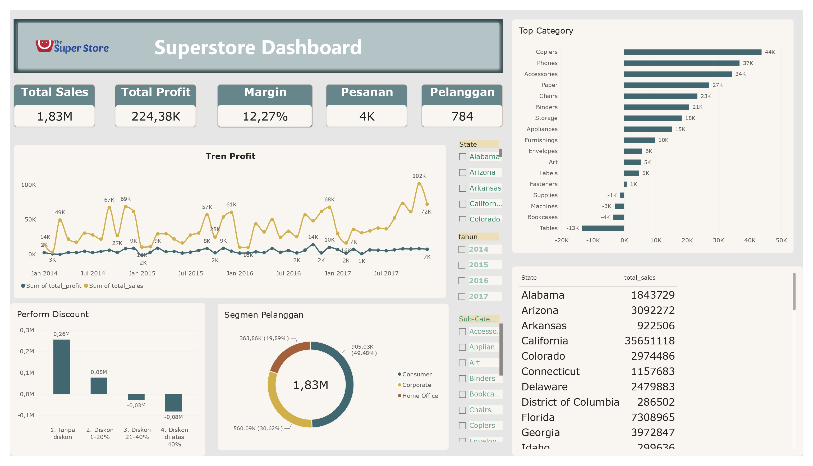

# Analisis Penjualan Superstore (SQL + Power BI)

Analisis data transaksi toko retail Amerika Serikat (Jan 2014 – Des 2017) untuk memahami tren penjualan, profitabilitas per kategori dan wilayah, serta pengaruh diskon terhadap profit. Proyek ini memakai SQL (MySQL) untuk eksplorasi, cleaning, dan analisis, lalu Power BI untuk dashboard.




## 1. Masalah Bisnis

**Stakeholder:** Manajer Penjualan.

Penjualan terus naik, tetapi margin profit belum ikut membaik. Pertanyaan yang dijawab:

- Bagaimana kinerja penjualan dan profit dari tahun ke tahun?
- Kategori dan sub-kategori apa yang paling untung dan paling rugi?
- Apakah diskon yang diberikan merugikan profit?
- Wilayah (region dan state) mana yang paling untung dan paling rugi?
- Segmen pelanggan mana yang paling bernilai?

## 2. Data

- **Sumber:** Sample - Superstore (Kaggle) — [https://www.kaggle.com/datasets/vivek468/superstore-dataset-final](https://www.kaggle.com/datasets/vivek468/superstore-dataset-final?resource=download)
- **Tabel sumber:** satu tabel transaksi (satu baris = satu produk dalam satu pesanan)
- **Tabel untuk dashboard:** enam tabel ringkasan hasil query SQL (tren bulanan, performa diskon, segmen pelanggan, kategori, profil state, dan performa state)
- **Mata uang:** USD (asumsi: data tidak mencantumkan mata uang, dan toko berlokasi di Amerika Serikat)
- **Periode:** Januari 2014 – Desember 2017 (48 bulan)

Data mentah tidak disertakan di repositori ini (sudah tersedia publik di Kaggle).

## 3. Proses Cleaning

| Temuan | Keputusan |
|---|---|
| 1 baris duplikat (pesanan US-2014-150119) | Dihapus (9.994 menjadi 9.993 baris) |
| Tanggal berformat M/D/YYYY (teks) | Diambil tahun dan bulannya |
| Periode 2014-01 s.d. 2017-12 lengkap | Tidak ada data yang dibuang |
| Profit negatif | Dipertahankan, ini kerugian nyata |
| Sales maksimum 22.638 dan profit minimum -6.600 | Dipertahankan, wajar untuk produk mahal dan diskon besar |
| Diskon punya 12 level berbeda | Dikelompokkan menjadi 4 kelompok |

Hasil cleaning dibuat sebagai view `clean_superstore`.

## 4. Metode dan Tools

- **SQL (MySQL):** agregasi, `GROUP BY`, `CASE WHEN` (pengelompokan diskon), subquery, dan fungsi tanggal
- **Power BI:** measure DAX, kartu KPI, line chart, bar dan column chart, donut chart, serta slicer (Tahun, State, Sub-Category)

## 5. Temuan Utama

| KPI | Nilai |
|---|---|
| Total sales | $1.828.987 |
| Total profit | $224.383 |
| Margin profit | 12,27% |
| Jumlah pesanan | 3.931 |
| Rata-rata nilai pesanan | $465,27 |
| Pelanggan unik | 784 |

1. **Sales naik, margin turun.** Sales 2017 naik 25,5% dari 2016 (menjadi $582 ribu), tetapi margin turun dari 12,74% menjadi 12,08%. Margin tertinggi tercatat pada 2015 (13,81%).
2. **Diskon adalah masalah utama.** Tanpa diskon margin 29,20%. Diskon 21–40% membuat margin -15,02%, dan di atas 40% margin -73,39%. Transaksi dengan diskon di atas 20% hanya 16% dari sales, tetapi menimbulkan kerugian $108,8 ribu (setara sekitar 48% dari total profit).
3. **Furniture besar tapi tipis.** Sales $583 ribu (hampir setara Technology) dengan margin hanya 2,78%, dibandingkan 16–17% pada kategori lain. Sub-kategori Tables merugi $13,4 ribu dan Bookcases $3,5 ribu. Penyumbang profit terbesar adalah Copiers, Phones, Accessories, dan Paper.
4. **Wilayah Central paling lemah.** Margin 8,84%, terendah di antara empat region (West 13,82%). Texas, Ohio, dan Pennsylvania merugi. Total 10 dari 49 state merugi (total -$78,7 ribu), dan enam state terendah (Ohio, Colorado, Illinois, Pennsylvania, Texas, North Carolina) memiliki rata-rata diskon 28–39%.
5. **Penjualan musiman.** September–Desember menyumbang sekitar 52,7% penjualan tahunan. Penjualan tertinggi terjadi pada November 2017 ($101,8 ribu), tetapi margin bulan itu hanya 7,9%.
6. **Segmen Home Office paling efisien.** Consumer menyumbang 49,5% sales dengan margin terendah (11,54%). Home Office hanya 19,9% dari sales, tetapi margin tertinggi (14,20%) dan rata-rata nilai pesanan terbesar ($513,93).

## 6. Rekomendasi


Rekomendasi di atas berisi lima langkah: (1) batasi diskon maksimal 20%, (2) tinjau kinerja state yang merugi, (3) tingkatkan profitabilitas Furniture, (4) siapkan puncak penjualan akhir tahun, dan (5) prioritaskan produk dan segmen unggulan. Tiap rekomendasi dilengkapi temuan, rekomendasi, dan indikator keberhasilan.

Rekomendasi 4 dan 5 adalah hipotesis yang perlu diuji, bukan kesimpulan pasti.

## 7. Keterbatasan

- Data Superstore adalah dataset contoh, bukan data perusahaan sebenarnya.
- Profit sudah tersedia di data, tetapi rincian biaya tidak ada, sehingga penyebab profit negatif tidak bisa dipastikan.
- Hubungan antara diskon dan profit adalah korelasi, bukan bukti sebab-akibat.
- Rata-rata diskon per state tidak mencerminkan diskon per transaksi.
- Lonjakan penjualan November 2017 diduga efek musiman akhir tahun, tetapi belum diverifikasi dengan data harian.
- Data hanya mencakup 2014–2017, jadi tidak mewakili kondisi terkini.
- Ambang diskon 20% adalah pengamatan dari data ini, bukan standar industri.
- Mata uang tidak tercantum di data; USD adalah asumsi.
- Dashboard memakai tabel ringkasan yang tidak saling berelasi, sehingga slicer hanya memfilter visual yang berasal dari tabel yang sama.
- Target keberhasilan pada rekomendasi adalah usulan awal, bukan target resmi perusahaan.

## 8. Cara Mereproduksi

1. Unduh dataset dari Kaggle.
2. Impor CSV ke MySQL sebagai tabel `erkuy`.`sample - superstore` (encoding ISO-8859-1).
3. Jalankan file di folder `sql/` berurutan: `01_eksplorasi.sql`, `02_cleaning.sql`, `03_analisis.sql`.
4. Hasil query yang diekspor tersedia di folder `clean/`.
5. Buka `dashboard_superstore.pbix` di Power BI Desktop. Jika angka desimal terbaca salah, atur **File → Options → Current File → Regional Settings** ke English (United States).

## Struktur Repository

```
sql/
├── 01_eksplorasi.sql
├── 02_cleaning.sql
└── 03_analisis.sql
clean/
├── Tren_bulanan.csv
├── Perfrom_Diskon.csv
├── Segmen_Pelanggan.csv
├── Top_Kategori.csv
├── Profil_Sales_By_state.csv
└── Perform_State.csv
images/             (dashboard.png, rekomendasi_bisnis_profesional.png)
dashboard_superstore.pbix
README.md
```

## Penulis

[Yudhoro Kunto Wibisono] · inkedin.com/in/yudhoro-kunto-wibisono-294734330/
